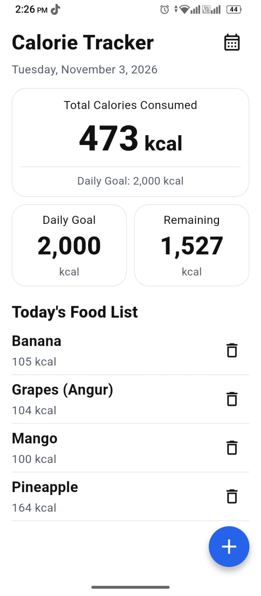
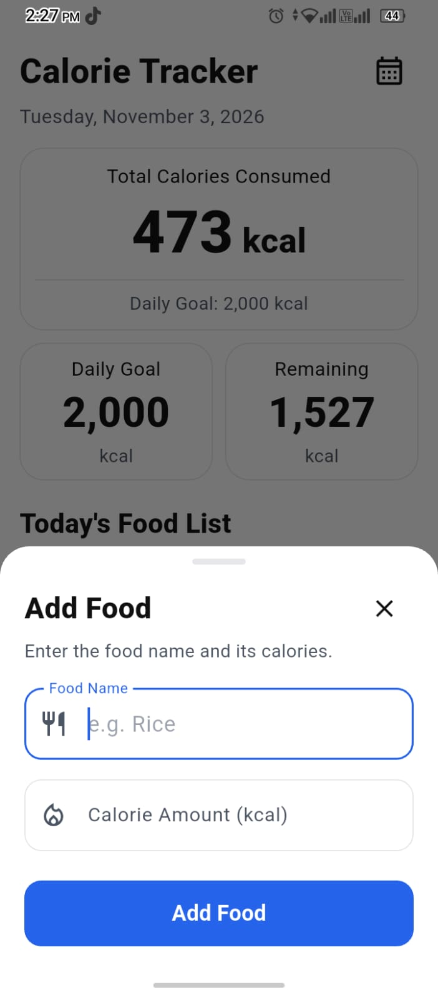

# Calorie Tracker (Flutter)


A simple Calorie Tracking app built with **Flutter**, **Riverpod** and **Clean Architecture**.
Users can add food items with calories, delete them, and see the total / goal / remaining calories for today.

> Data is stored in a local `List` only. No database, no API. Data resets when the app restarts.

## Screenshots

| Dashboard | Add Food |
|:---:|:---:|
|  |  |

## Features

- Home screen with app name, today's date and calendar icon
- 3 summary cards (Material `Card`): **Total Calories**, **Daily Goal (2,000 kcal)**, **Remaining**
- **Add Food** (floating action button -> bottom sheet form)
  - Food name and calorie amount are required
  - Calorie must be a valid positive number
- Food list using `ListView.builder` with a delete button on each item
- Totals update automatically on add / delete (Riverpod)
- Remaining calories turn red when the goal is exceeded
- Whole page scrolls together; responsive layout (small phone to tablet)

## Tech

| Item | Choice |
|------|--------|
| Framework | Flutter (Material 3) |
| State management | `flutter_riverpod` (`Notifier` + `Provider`) |
| Architecture | Clean Architecture (core / data / domain / presentation) |
| Storage | In-memory `List` |

## Folder Structure

```
lib/
├── main.dart
├── core/
│   ├── constants/app_constants.dart
│   ├── theme/            (app_colors.dart, app_theme.dart)
│   └── utils/            (date_formatter, number_formatter, validators)
├── data/
│   ├── models/food_model.dart
│   ├── datasources/food_local_datasource.dart
│   └── repositories/food_repository_impl.dart
├── domain/
│   ├── entities/food_entity.dart
│   ├── repositories/food_repository.dart
│   └── usecases/         (get_foods, add_food, delete_food)
└── presentation/
    ├── providers/        (food_providers, food_notifier,calorie_summary_providers) 
    ├── screens/home_screen.dart
    └── widgets/
        ├── common/       (summary_card_container)
        ├── header/       (app_header, date_label)
        ├── summary/      (total_calories_card, mini_summary_card, summary_section)
        ├── food_list/    (food_list_section, food_list_item, empty_food_view)
        └── add_food/     (add_food_button, add_food_sheet, add_food_form, add_food_field, add_food_submit_button)
```

## Run the project

This repository contains `lib/`, `pubspec.yaml` and config files. If the platform folders
(`android/`, `ios/`, ...) are missing, generate them first:

```bash
flutter create .          # generates platform folders (lib/ and pubspec.yaml stay untouched)
flutter pub get
flutter run
```

## Project Checklist

- [x] App name, today's date, summary card, daily goal, remaining calories
- [x] Add Food button + form (name, kcal) with validation
- [x] Positive-number validation for calories
- [x] `ListView.builder` food list with delete button
- [x] Total auto-updates on add / delete
- [x] 3 summary cards (Total, Goal, Remaining)
- [x] Local `List` only (no Firebase / SQLite / API)
- [x] Material widgets, `Card`, `FloatingActionButton`

## Test

```bash
flutter test      # runs layout checks on 4 screen sizes (small phone -> tablet)
```